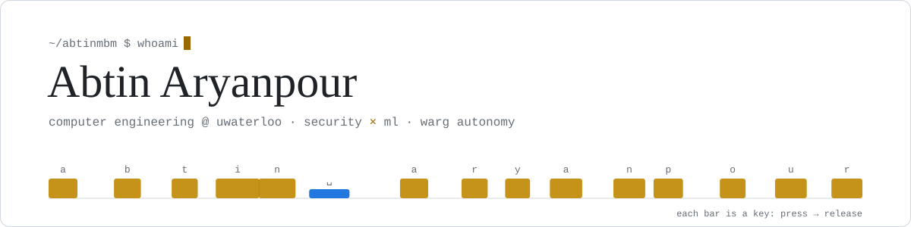
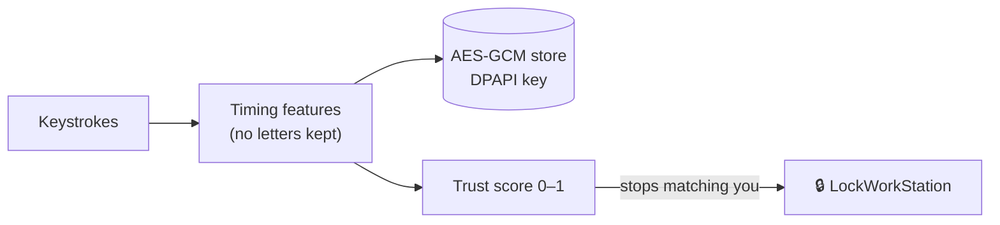

<picture>
  <source media="(prefers-color-scheme: dark)" srcset="assets/header-dark.svg">
  
</picture>

[LinkedIn](https://www.linkedin.com/in/abtin-aryanpour/) · [aaryanpo@uwaterloo.ca](mailto:aaryanpo@uwaterloo.ca) · open to a Summer 2027 co-op

Hey, I'm Abtin, a first-year Computer Engineering student at the University of Waterloo. I like security and machine learning, and I like it best when I can **measure** whether the thing I built actually works.

My brother used to wait until I walked away from my unlocked PC. So I built a program that learns how I type and locks the screen when someone else sits down. That's **Doppel.exe**, and it's still the project I'm proudest of.

## Right now

| | |
| --- | --- |
| 🔐 **[Doppel.exe](https://github.com/abtinmbm/doppel)** | Continuous authentication for Windows. Typing works end to end in a dry run; next up are writing style, then attacking it myself. |
| 🛩️ **WARG, Autonomy** | Working on ground-station image stitching for the Waterloo Aerial Robotics Group's multi-drone mapping. |
| 🔊 **Andon** | Listening for machine faults: anomaly detection on machine sounds, in software first and then on a Raspberry Pi Pico. |

## How Doppel works

Results so far, each one measured and reproducible from the repo:

- **0.0002** mean EER away from the published CMU keystroke benchmark, so the evaluation code is checked before any tuning
- **~7× fewer errors** on the 136M-keystroke Aalto dataset (EER 0.164 → 0.023), chosen on 500 users and confirmed on 500 others
- **90% of impostors locked out** at their first window in a 498-user simulation, at 1.99 false locks per 1,000 owner keystrokes

## Earlier work

| Project | What it is | Stack |
| --- | --- | --- |
| **[CyberShield](https://github.com/abtinmbm/cybershield)** | Cybersecurity discussion forum with a live feed, voting, moderation and fuzzy search. **1st of 32 teams**, FBLC Canada 2025, as sole developer on a team of three. | Django, DRF, JavaScript, Tailwind, AWS |
| **[School Partner Directory](https://github.com/abtinmbm/FBLA2024)** | Directory connecting schools with community partners, with profiles, sharing and search. **4th of 32 teams**, FBLA Canada 2024. | Django, Tailwind, jQuery, Fuse.js |

## Tools

  

## Outside of code

📷 Photography/Videography · 📚 Manga and movies · 🎮 Gaming · 🏀 Basketball and pickleball 
