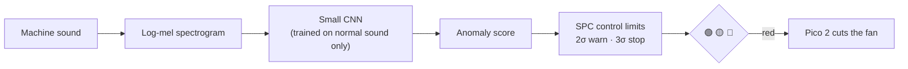
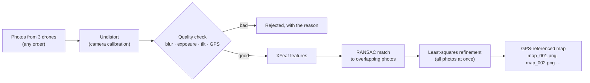

<picture>
  <source media="(prefers-color-scheme: dark)" srcset="assets/header-dark.svg">
  
</picture>

[LinkedIn](https://www.linkedin.com/in/abtin-aryanpour/) · [aaryanpo@uwaterloo.ca](mailto:aaryanpo@uwaterloo.ca) · open to a Summer 2027 co-op

Hey, I'm Abtin, a first-year Computer Engineering student at the University of Waterloo. 

## Right now

| | |
| --- | --- |
| 🔊 **[Andon](https://github.com/abtinmbm/andon)** | An andon light that listens: it learns what a healthy machine sounds like and turns green / yellow / red when it starts to sound wrong. The software is done; next it runs on a Raspberry Pi Pico 2 that cuts power to a real fan when it hears a fault. |
| 🛩️ **WARG, Autonomy** | Building the ground-station image stitcher for the Waterloo Aerial Robotics Group's multi-drone mapping ([PR #215](https://github.com/UWARG/autonomy-monorepo/pull/215), in review). It merges photos arriving out of order from several drones into one GPS-referenced map: lens undistortion, rejection of blurry or tilted photos, XFeat feature matching with RANSAC, and a least-squares refinement that removes drift. In simulation, photos line up to within 7 cm under 3 m GPS error. |

## How Andon works

Results on the DCASE 2020 Task 2 factory-sound benchmark, scored once on the eval set, mean ± std over 3 seeds:

- **92.13 ± 0.16% AUC** at telling faulty sound from normal, against 79.70 ± 0.39% for the official autoencoder baseline (which I reproduced first, within 0.3 points of the published number)
- **98.7 KB** as an int8 model, small enough for a microcontroller, losing only 0.04 ± 0.02 AUC points
- As a live andon light: catches **65.57 ± 1.02%** of faults, turning red **10.57 ± 0.24 s** after a fault starts

## How the stitcher works

Results on synthetic 3-drone missions with known ground truth (simulated; 5 seeds at each of 1 m and 3 m GPS error, flight data comes later):

- **10 of 10** missions stitched into one connected map, with 0 good photos rejected
- Photos line up with each other to **4.2–6.9 cm**
- The whole map lands within **0.16–0.31 m** of its true position with 1 m GPS error, **0.47–0.94 m** with 3 m
- **0.42–0.75 s** per photo on CPU

## Projects

| Project | What it is | Stack |
| --- | --- | --- |
| **[Doppel.exe](https://github.com/abtinmbm/doppel)** | Continuous authentication for Windows: learns how you type (timing only, no letters stored) and locks the screen when someone else is at the keyboard. Finished as a working dry run; cut errors ~7× on the 136M-keystroke Aalto dataset (EER 0.164 → 0.023). | Python, NumPy, pandas, cryptography, pywin32 |
| **[CyberShield](https://github.com/abtinmbm/cybershield)** | Cybersecurity discussion forum with a live feed, voting, moderation and fuzzy search. **1st of 32 teams**, FBLC Canada 2025, as sole developer on a team of three. | Django, DRF, JavaScript, Tailwind, AWS |
| **[School Partner Directory](https://github.com/abtinmbm/FBLA2024)** | Directory connecting schools with community partners, with profiles, sharing and search. **4th of 32 teams**, FBLA Canada 2024. | Django, Tailwind, jQuery, Fuse.js |

## Tools

  

## Outside of code

📷 Photography/Videography · 📚 Manga and movies · 🎮 Gaming · 🏀 Basketball and pickleball 
